# phoenix-ac

## Premessa

<table border="1" width="100%" cellpadding="16" cellspacing="0">
  <tr>
    <td>
      <p><strong>Perché ho messo online le sorgenti (self-leak)</strong></p>
      <p>Il leak è <strong>volontario</strong>. Sono uscito da phoenix-ac / Enveart e ho pubblicato il repo perché non resti solo la versione raccontata in <strong>live</strong> o su Discord.</p>
      <p>Dietro anti-cheat e server c'è stato un disastro di <strong>management</strong>: <strong>promesse non mantenute</strong>, <strong>pagamenti mancati</strong>, risposte che <strong>evitavano</strong> il punto invece di risolvere. In <strong>live su Twitch</strong>, e da <strong>altre persone</strong>, sono uscite affermazioni che <strong>non tornavano</strong> con ciò che c'era davvero, che <strong>non sono mai arrivate</strong>, o che erano <strong>semplicemente false</strong>.</p>
      <p>Ho <strong>lasciato il progetto</strong> e ho <strong>leakkato tutto</strong> qui. Il resto del README descrive la <strong>struttura</strong> del prodotto <strong>com'era</strong> quando ho chiuso: architettura, cartelle e flussi, così si può verificare sui fatti e non solo a parole.</p>
      <p><strong>Sull'AI:</strong> non vendo la favola che Claude abbia scritto tutto da solo. Su <strong>v1/v2</strong> il modello pesava troppo e l'architettura ne ha risentito. Su <strong>v3 e Latest</strong> ho usato Claude anche per generare codice, sì, ma <strong>struttura</strong>, <strong>architettura</strong> e <strong>decisioni</strong> le ho messe io. Stesso tool, modo diverso di lavorarci.</p>
      <p><em>(Per chiarezza: anche tutto il README l'ho messo su in fretta con Claude, non solo questo box; contenuti e motivazioni restano miei. 😄)</em></p>
    </td>
  </tr>
</table>

---

FiveM anti-cheat: Windows agent (+ optional kernel driver), Node backend, Next.js site, FiveM Lua resource. **This git repository contains all product lines** (v1 through Latest) as top-level folders. **Run new deployments from:** `Phoenix-v3-Uhm-Latest/` (server) + `Phoenix-v3-Uhm/` (Windows client).

## History

**AI disclosure:** not "Claude wrote the whole repo." **v1/v2** leaned on the model with weak architecture (v1 especially: throwing output at Claude without real design). **v3 and Latest are mine:** I authored them using Claude as a tool, but under **my own logic**, **my own knowledge**, and explicit structure (review, constraints, net layout). Same assistant, different process. That still does not make the design great; it explains why v3/Latest are not the same thing as v1.

All folders stay **in this repo** for history. Do not deploy v1/v2. Use v3-Uhm for the client and Latest for the server.

| Directory | Ver. | Use now | How it was made / verdict |
| --- | --- | --- | --- |
| Phoenix-v1-Hydro | v1 | no | Claude + no competence: incompetent architecture, bad netcode, monolithic client C++. |
| Phoenix-v2-Hydro-Refactor-Uhm | v2 | no | Claude with some skill, but rushed refactor from v1 source (time). Still sucks; inherited junk. |
| Phoenix-v3-Uhm | v3 | client | **My work.** Full stack (agent, driver, updater, script). Claude assisted; architecture and decisions are personal. |
| Phoenix-v3-Uhm-Latest | Latest | server | **My work.** Control plane rewrite/consolidation. Claude assisted; personal logic and skills. Works; mediocre netcode; should be rewritten. Least bad. |

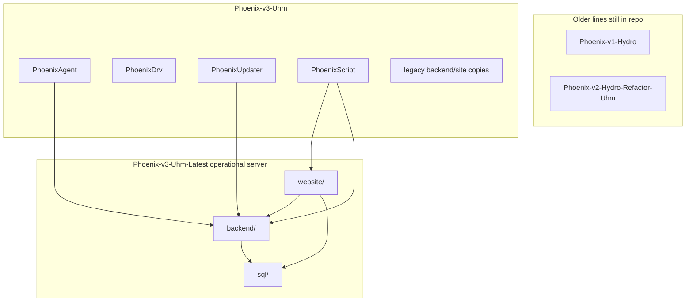

Latest is maintainership **by me** after v1/v2/v3 chaos. Read `AgentSession`, count PAC1 + PAC1 update + PHX + HTTP, and it is clear why the codebase **generally sucks** even when it runs. One net stack and a rewrite would be the sane next step.

## System overview

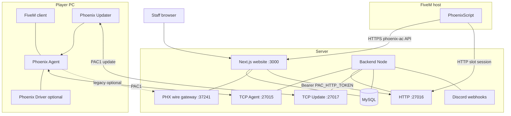

## Latest backend layout

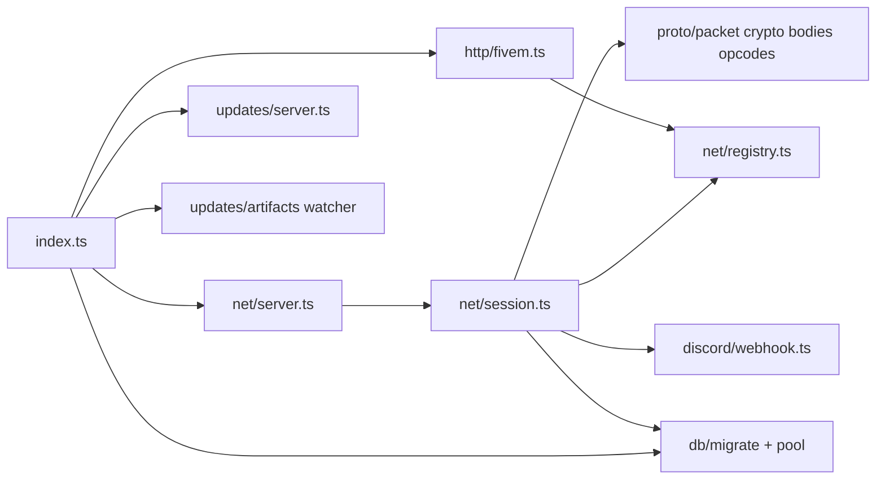

## Website layout

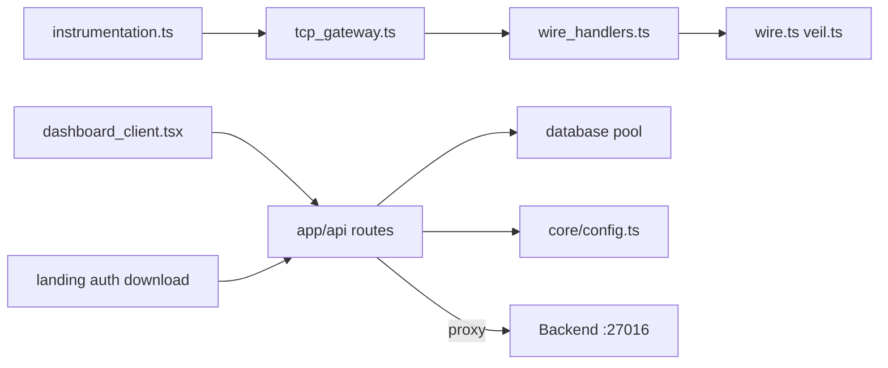

## Backend boot sequence

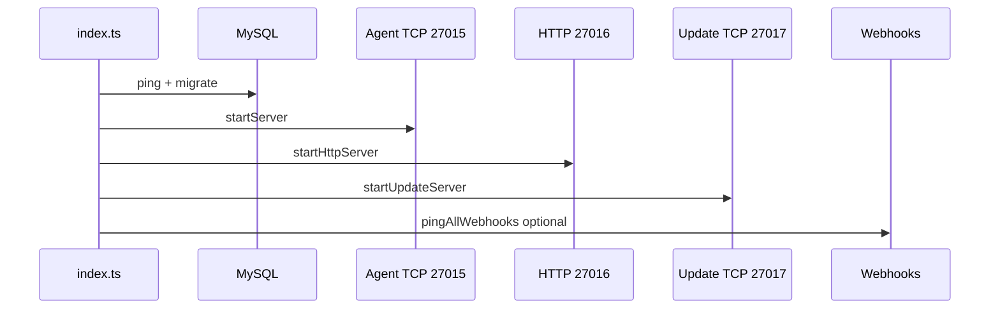

## Usage

1. Apply `Phoenix-v3-Uhm-Latest/backend/sql/schema.sql` or let backend migrate on boot.
2. Configure `backend/.env` and `website/.env.local` (never commit secrets).
3. Run backend: `cd Phoenix-v3-Uhm-Latest/backend && npm ci && npm run build && node dist/index.js`
4. Run website: `cd Phoenix-v3-Uhm-Latest/website && npm ci && npm run build && npm start`
5. Point `BACKEND_URL` at HTTP `:27016` with `PAC_HTTP_TOKEN`.
6. Build agent/driver/updater from `Phoenix-v3-Uhm/` (Release x64) and place artifacts per config.

## PAC1 agent session

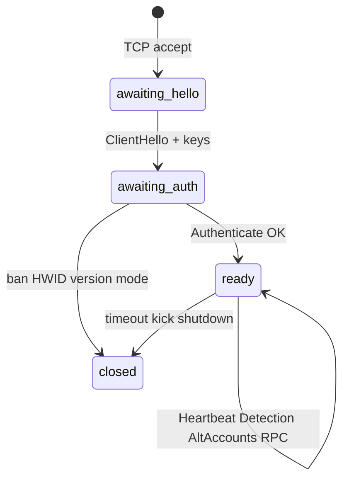

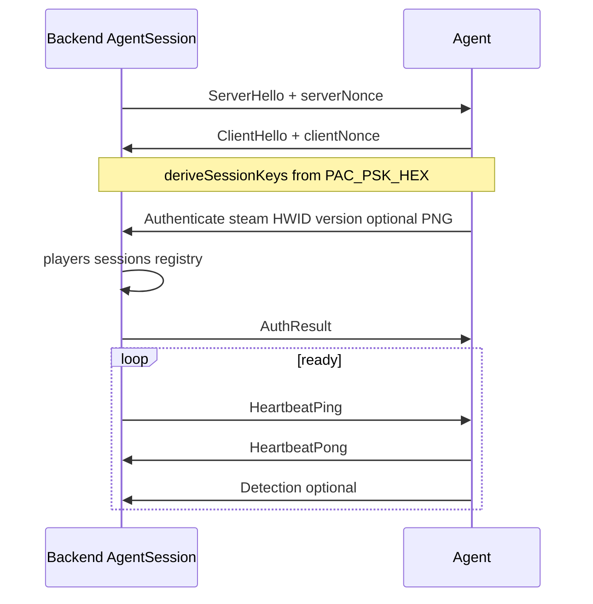

Magic `0x50414331`, version `0x0001`. Handshake frames cleartext; then encrypted AES+HMAC with replay window. Opcode list: `backend/src/proto/opcodes.ts`.

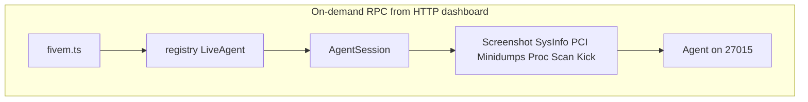

## Update channel (27017)

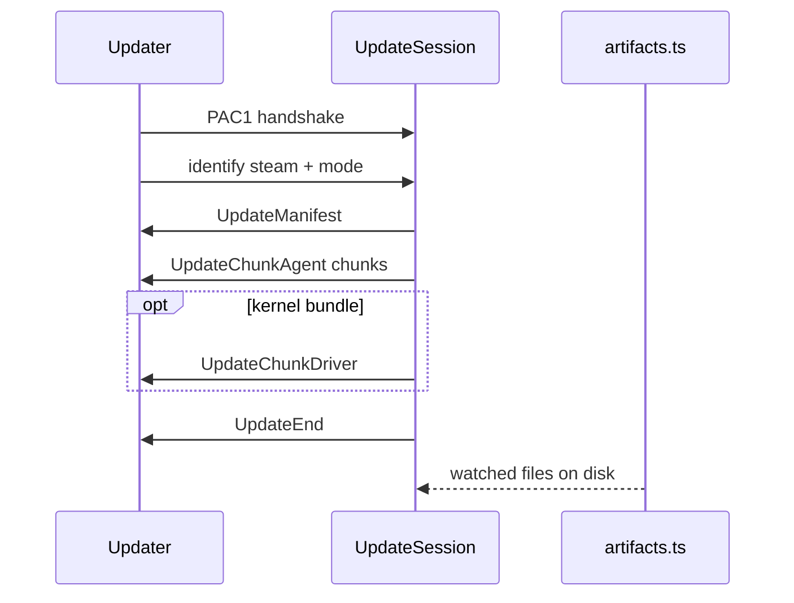

## PHX legacy wire (website :37241)

Parallel stack inside Next.js (not PAC1). Magic `0x31584850`, AES-GCM + veil + HMAC. Opcodes: AuthCheck, Event, UpdateCheck, UpdateDownload (`website/lib/net/wire.ts`).

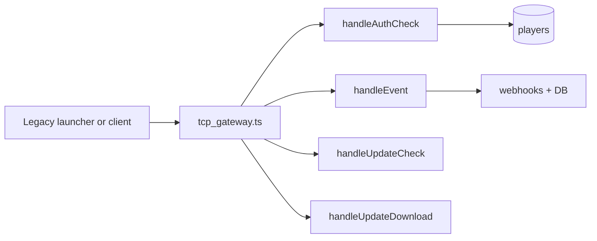

## Staff dashboard live action

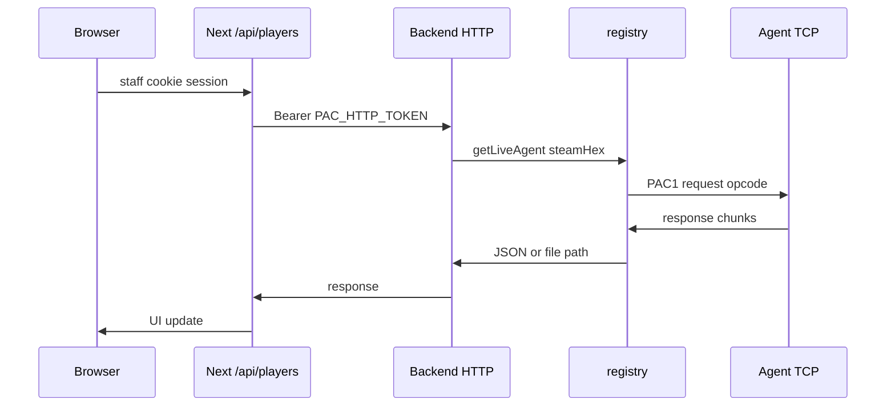

## FiveM + player flow

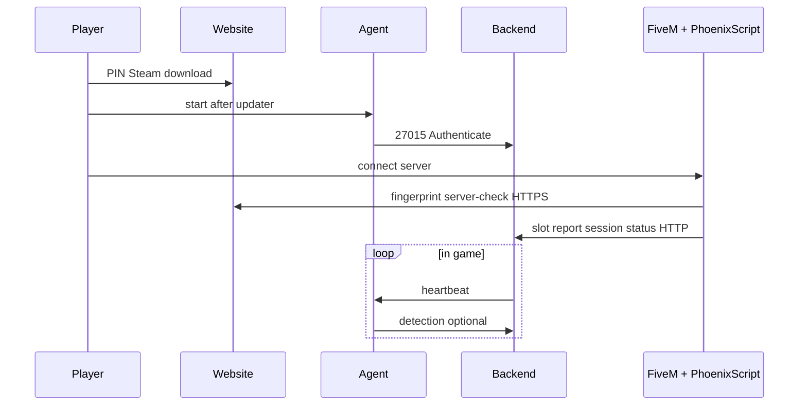

## HTTP surface (backend :27016)

Bearer `PAC_HTTP_TOKEN`. Router: `backend/src/http/fivem.ts`.

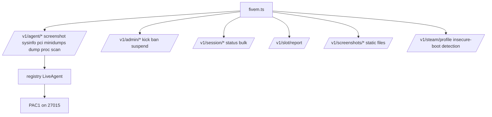

## Website HTTP surface

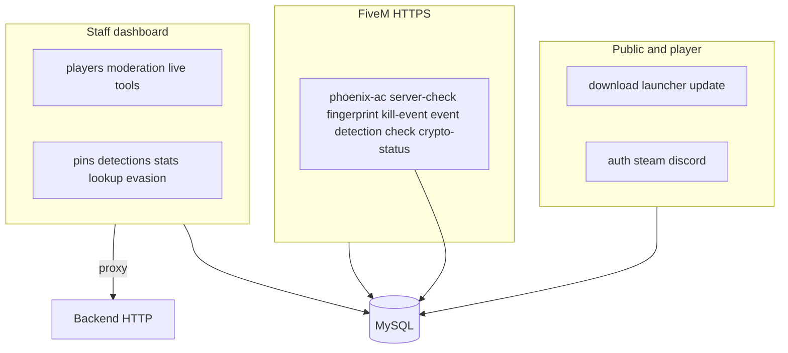

Route files under `website/app/api/`.

## MySQL model

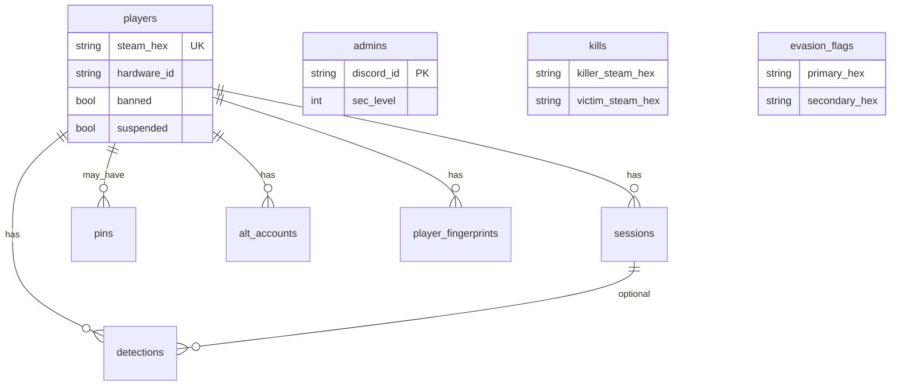

Schema file: `Phoenix-v3-Uhm-Latest/backend/sql/schema.sql`.

## Discord notifications

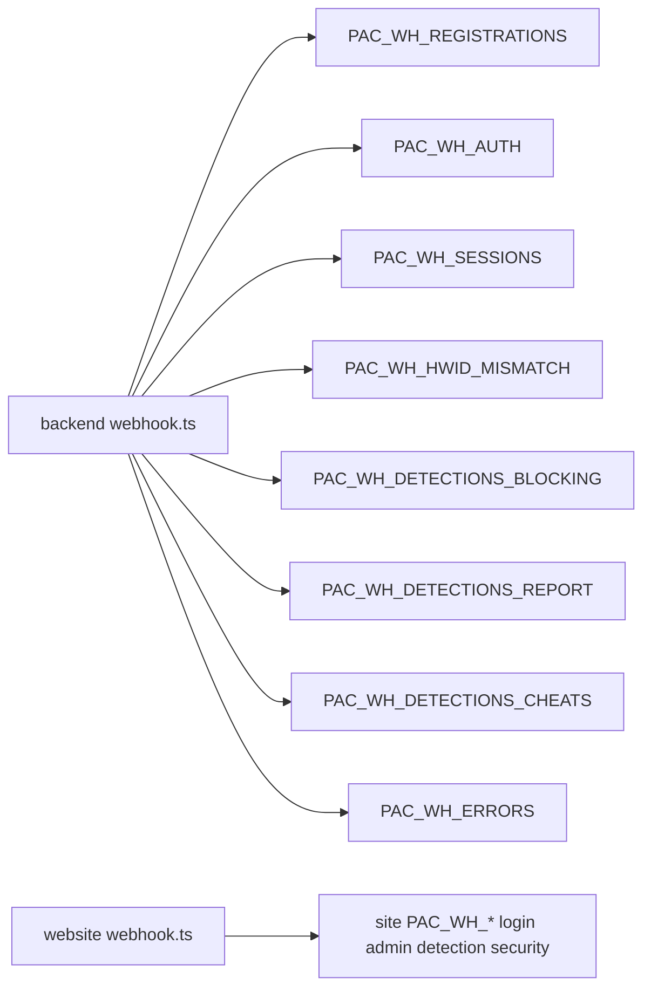

## Windows agent (Phoenix-v3-Uhm)

Not in Latest repo; peers with backend PAC1.

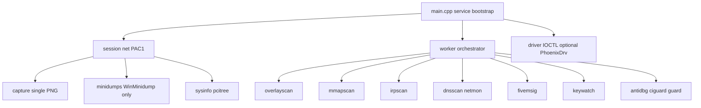

Screenshots are single frames (GDI / DXGI / NVIDIA scanout), not live streaming. DumpFile reads only `%WinDir%\Minidump\*.dmp` with sanitized names.

## Building

Requirements: Node.js LTS + MySQL 8 for Latest; Visual Studio C++ x64 for `Phoenix-v3-Uhm/`.

```bash
cd Phoenix-v3-Uhm-Latest/backend && npm ci && npm run build
cd ../website && npm ci && npm run build
```

Agent/driver/updater: open `.vcxproj` under `Phoenix-v3-Uhm/`, Release | x64, align `PhoenixDrv/shared/config.hpp` hosts/ports with backend env.

## Known limits

None of this is "we will fix it later" hand-waving. These are structural problems you see once you trace a dashboard click to a PAC1 opcode.

- **Registry in memory:** one backend process owns live agents. Restart the node and live mappings are gone. No real horizontal scale.
- **Protocol soup:** PAC1 + PAC1 update + PHX wire + HTTP BFF. Same concepts implemented twice (PHX vs backend).
- **`AgentSession` monolith:** thousands of lines mixing framing, DB, webhooks, disk IO, and pending RPC. Easy to break, hard to test.
- **Split repo layout:** Latest without v3-Uhm binaries is incomplete; releases depend on artifact paths and manual alignment.
- **v1 / v2:** incompatible with Latest. Keep them only to see how not to do it.

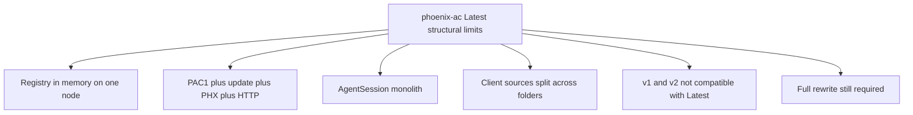

## License

No `LICENSE` file in this monorepo.
